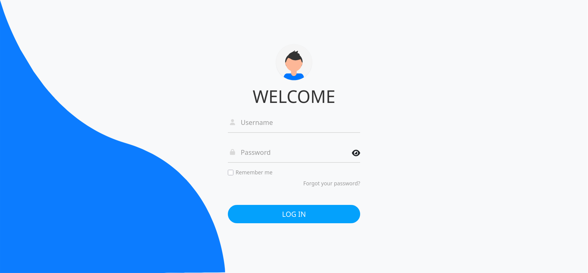
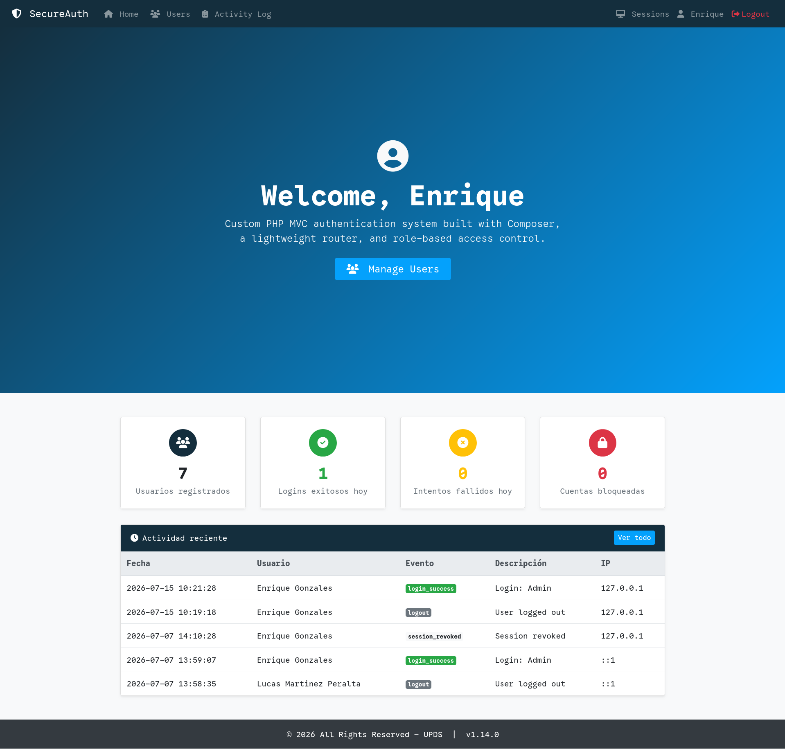
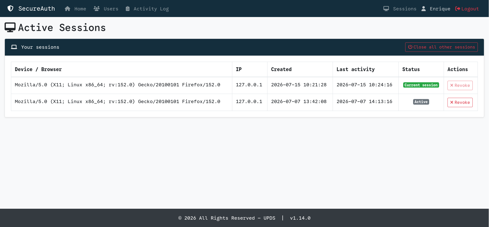
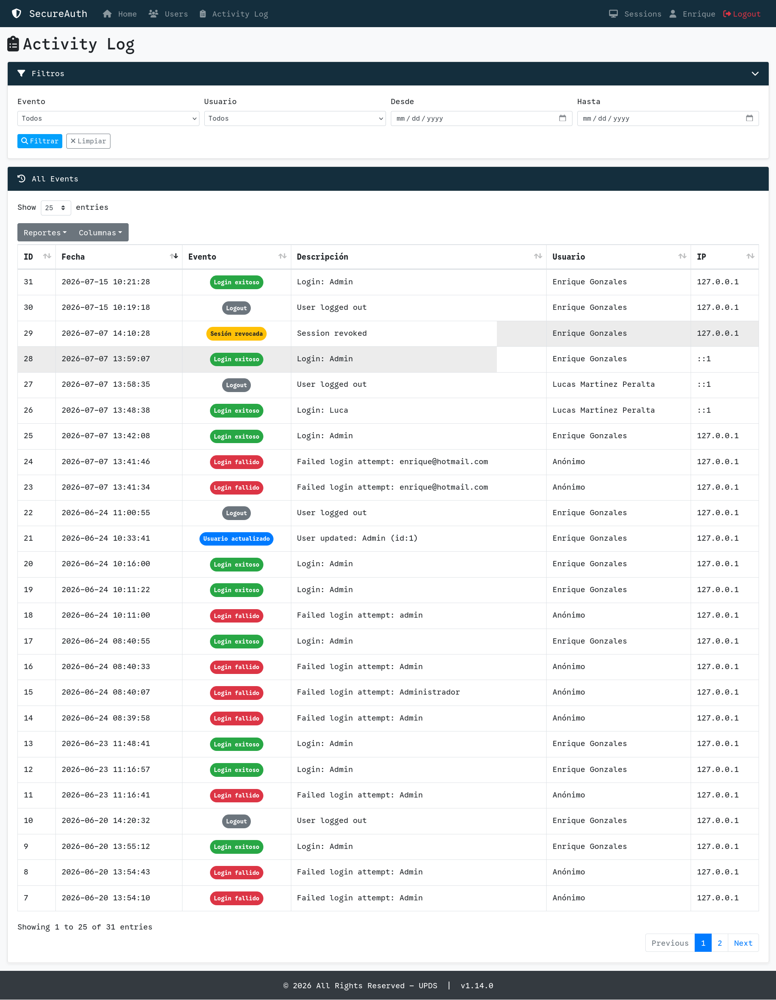

<div align="center">

# SecureAuth — PHP MVC Authentication System

[](https://github.com/jandrescodes/Encriptacion_PHP/releases/tag/1.16.0)
[](https://github.com/jandrescodes/Encriptacion_PHP/actions/workflows/tests.yml)
[](https://php.net/)
[](https://github.com/PHPMailer/PHPMailer)
[](LICENSE)

Custom PHP MVC authentication system built with Composer, a lightweight router, and role-based access control.

</div>

## Table of Contents

- [SecureAuth — PHP MVC Authentication System](#secureauth--php-mvc-authentication-system)
  - [Table of Contents](#table-of-contents)
  - [Screenshots](#screenshots)
    - [Login](#login)
    - [Dashboard](#dashboard)
    - [Active Sessions](#active-sessions)
    - [Activity Log](#activity-log)
  - [Features](#features)
  - [Requirements](#requirements)
  - [Installation](#installation)
    - [Google OAuth Setup](#google-oauth-setup)
  - [Project Structure](#project-structure)
  - [Usage](#usage)
  - [URL Routing](#url-routing)
  - [Security](#security)
  - [Cache](#cache)
  - [Testing](#testing)
    - [Local setup](#local-setup)
    - [CI](#ci)
  - [Contributing](#contributing)
  - [License](#license)

## Screenshots

### Login

Secure login form with account lockout, email-based password recovery, and an optional **Continue with Google** (OAuth 2.0 + OpenID Connect) button.



---

### Dashboard

Live metrics — total users, logins today, failed attempts, and locked accounts — plus a feed of recent audit events.



---

### Active Sessions

Every active login, with device/browser and IP, and the ability to revoke individual sessions or all but the current one.



---

### Activity Log

Full audit trail with server-side filtering by event type, username, and date range.



## Features

**Authentication & Account Management**

- Login with bcrypt password hashing, account lockout after repeated failed attempts, and email-based password recovery
- **Continue with Google** (OAuth 2.0 + OpenID Connect, Authorization Code flow) — feature-flagged, account auto-creation or linking by Google-verified email, works alongside password login ("hybrid" accounts) — see [Google OAuth Setup](#google-oauth-setup)
- Persistent login (Remember Me) and automatic session timeout on inactivity
- Self-service user profile — edit personal info or change password at `/profile`
- **Accessible auth forms (WCAG 2.1 AA)** — real `<label>`s, an `<h1>` per page, `autocomplete` on every field, a keyboard-focusable password toggle (`aria-pressed`), decorative images/icons hidden from assistive tech, a 24 px Remember-me target, contrast-safe text, and `prefers-reduced-motion` support; the reset form exposes a hidden `username` field so password managers associate the account

**Administration**

- Full user CRUD with role-based access control
- Active sessions management — view and revoke logins per device at `/sessions`
- Audit log of security and admin events, filterable and exportable, at `/activity-logs`
- Dashboard with live metrics — total users, logins today, failed attempts, locked accounts

**Architecture & Tooling**

- Custom MVC core (`App\Core\Router`, `Controller`, `Model`) with PSR-4 autoloading via Composer
- Cache for the users listing (file by default, optional Redis/Valkey), with automatic invalidation on writes; optional Redis-backed PHP sessions and per-IP login throttling — everything degrades gracefully if Redis is down
- DataTables-powered tables with export (Copy, PDF, Excel, CSV, Print) and column visibility toggle
- SweetAlert2 notifications for CRUD and authentication feedback
- 143-test PHPUnit suite (unit + integration) running against a real MySQL database, with CI via GitHub Actions

> See [Security](#security) below for how each of these is implemented under the hood.

## Requirements

- PHP >= 8.2
- MySQL / MariaDB
- Apache with `mod_rewrite` (XAMPP recommended)
- Composer
- Gmail account with an App Password (or any SMTP provider)
- Optional — for "Continue with Google": a Google Cloud project with a **Web application** OAuth 2.0 Client ID/Secret (see [Google OAuth Setup](#google-oauth-setup))

## Installation

1. Clone the repository:

```bash
git clone https://github.com/jandrescodes/Encriptacion_PHP.git
cd Encriptacion_PHP
```

2. Install dependencies:

```bash
composer install
```

3. Copy and configure the environment file:

```bash
cp .env.example .env
```

Edit `.env` with at least your DB credentials and SMTP settings (see `.env.example` for the full list of variables and defaults).

4. Import the database schema:

```bash
mysql -u root -p < database/schema.sql
```

5. (Optional) Load sample data:

```bash
mysql -u root -p < database/seeds.sql
```

6. Place the project in your server's web root (e.g. `htdocs/` in XAMPP) and open `APP_URL` in your browser.

### Google OAuth Setup

This step is optional. Without it the app works normally but the "Continue with Google" button on the login page is hidden.

1. Go to the [Google Cloud Console](https://console.cloud.google.com/), create a project (or use an existing one), then **APIs & Services → OAuth consent screen** and fill in the app name and support email (Testing status is fine for localhost).
2. Under **APIs & Services → Credentials → Create credentials → OAuth client ID** choose **Web application** and add your redirect URI in **Authorized redirect URIs**:
   ```
   http://localhost/Encriptacion_PHP/public/auth/google/callback
   ```
   (Use `https://` + your real domain in production.)
3. Copy the **Client ID** and **Client Secret** into your `.env`:
   ```dotenv
   OAUTH_GOOGLE_ENABLED=true
   OAUTH_GOOGLE_CLIENT_ID=xxxx.apps.googleusercontent.com
   OAUTH_GOOGLE_CLIENT_SECRET=GOCSPX-...
   OAUTH_GOOGLE_REDIRECT_URI=http://localhost/Encriptacion_PHP/public/auth/google/callback
   ```
   The flag is `false` by default — the routes and the login button no-op with a flash message until you set it to `true`.
4. Reload the login page — the **Continue with Google** button appears.

> Implementation is pure PHP (cURL + custom methods), no third-party OAuth library. See the OAuth bullet under [Security](#security) for the guarantees.

## Project Structure

```
├── app/            # MVC core — Config, Controller, Core, Middleware, Model, Service
├── database/        # Schema, test schema, and seed data
├── libs/            # File-based cache implementation
├── public/           # Web root — front controller, CSS/JS/fonts, .htaccess
├── routes/           # Route definitions
├── storage/          # Runtime cache (not web-accessible)
├── views/            # PHP views, grouped by feature; shared layouts in views/layouts/
├── tests/            # PHPUnit unit + integration suite
├── .env.example      # Environment variable template
├── phpunit.xml       # PHPUnit configuration
└── composer.json     # Dependencies and PSR-4 autoload
```

See [CLAUDE.md](CLAUDE.md) for the full file-by-file breakdown.

## Usage

1. Open `http://localhost/Encriptacion_PHP/public/` in your browser
2. Log in with a seeded user (e.g. username `Admin`, password `Admin1234`)
3. Click your username in the nav to access your **profile** — edit info or change password
4. Visit `/sessions` to view your active sessions and revoke any device individually or all-but-current
5. Admin users (`is_admin = 1`) see the **Users** and **Activity Log** links in the nav → full CRUD and audit history
6. To recover a password, click "Forgot your password?" on the login page

## URL Routing

All routes are declared in `routes/web.php` and dispatched by `App\Core\Router`:

| URL                            | Controller method                                                                 |
| ------------------------------ | --------------------------------------------------------------------------------- |
| `/`                            | `HomeController::index()`                                                         |
| `/login`                       | `AuthController::login()`                                                         |
| `POST /logout`                 | `AuthController::logout()`                                                        |
| `GET /auth/google`             | `AuthController::googleLogin()` — redirects to Google (feature-flagged)           |
| `GET /auth/google/callback`    | `AuthController::googleCallback()` — OAuth callback, resolves/creates the account |
| `/forgot-password`             | `AuthController::forgotPassword()`                                                |
| `/reset-password?token=...`    | `AuthController::resetPassword()`                                                 |
| `/profile`                     | `ProfileController::profile()`                                                    |
| `POST /profile/password`       | `ProfileController::changePassword()`                                             |
| `/users`                       | `UserController::index()`                                                         |
| `/users/create`                | `UserController::create()`                                                        |
| `/users/edit?id=X`             | `UserController::edit()`                                                          |
| `POST /users/delete`           | `UserController::delete()`                                                        |
| `/activity-logs`               | `ActivityLogController::index()`                                                  |
| `/activity-logs/data`          | `ActivityLogController::data()`                                                   |
| `/sessions`                    | `SessionController::index()`                                                      |
| `POST /sessions/revoke`        | `SessionController::revoke()`                                                     |
| `POST /sessions/revoke-others` | `SessionController::revokeOthers()`                                               |

## Security

- Passwords hashed with bcrypt (`PASSWORD_DEFAULT`)
- Session set only after successful `password_verify()`; `session_regenerate_id(true)` called immediately after to prevent session fixation
- **Secure session cookie** — `session_start_secure()` helper enforces `HttpOnly`, `SameSite=Lax`, and `Secure` (on HTTPS) on every session start — including after logout and session timeout. `Lax` (not `Strict`) so the session survives the cross-site top-level navigation the Google OAuth callback performs, while still blocking cross-site POST (CSRF)
- **Google OAuth** — one-shot `state` parameter validated with `hash_equals()` and consumed before any side effect; account resolution links only Google-verified emails; Google-only accounts (`password = NULL`) never reach `password_verify()` and are refused by password reset; hybrid accounts log in with either method; requests to Google go through cURL with SSL verification and timeouts, and the `client_secret` is read from the environment, never logged
- **HTTP Security Headers** — `X-Frame-Options: DENY`, `X-Content-Type-Options: nosniff`, `Referrer-Policy`, `Content-Security-Policy`, `Permissions-Policy` set in `public/.htaccess` via `mod_headers`; HSTS commented out, ready for HTTPS
- **CSRF tokens** on all POST forms — generated via `App\Core\Csrf::token()`, validated with `hash_equals()` in every controller; **token rotated** after each successful verification
- **Logout is POST-only** — protected by CSRF token; prevents logout CSRF via `` or link
- Reset tokens: 256-bit (`bin2hex(random_bytes(32))`), 1-hour expiry, single-use, stored as SHA-256 hash in DB
- **User enumeration prevention** — `forgot-password` always returns the same generic response regardless of whether the email is registered
- All DB queries via MySQLi prepared statements
- **Self-hosted assets** — no external CDN in any view; eliminates supply-chain risk and `Referer` header token leakage
- Email validated with `filter_var()` before DB lookup
- SMTP with STARTTLS (port 587)
- Remember-me: raw token in cookie, SHA-256 hash in DB — cookie is `HttpOnly`, `SameSite=Strict`, `Secure` on HTTPS (the remember-me cookie stays `Strict`; only the session cookie is `Lax`, for the OAuth callback)
- Session timeout enforced on every protected request; clears remember cookie to prevent silent re-login
- User delete requires POST — not exploitable via `` or link prefetch
- **Admin self-protection** — admins cannot delete their own account or remove their own `is_admin` flag
- **Account lockout** — 5 consecutive failed logins lock the account for 15 min (configurable); only tracked for existing usernames; lockout cleared on successful login or password reset
- **Custom error pages** — 404, 403, 500 views are standalone (no DB/session dependency); DB errors logged via `error_log()`, never exposed to the browser
- **Audit log** — `ActivityLog::log()` wrapped in try/catch so a logging failure never aborts the main flow; IP from `$_SERVER['REMOTE_ADDR']` only; records preserved via FK `ON DELETE SET NULL` when user is deleted
- **Redis sessions (optional)** — `SESSION_DRIVER=redis` uses the native phpredis handler with locking and `session.use_strict_mode=1`; falls back to files if Redis is unreachable. Session payload (`session_token`, CSRF token, OAuth `state`) is stored in clear in Redis, like in the session files today, and the key is the session ID: protect Redis with the ACL user, local `bind` and no persistence (`docs/redis/redis.conf.example`)
- **Per-IP login throttle (optional)** — `LOGIN_IP_THROTTLE_ENABLED=true` limits login attempts per IP (`LOGIN_IP_MAX_ATTEMPTS` per `LOGIN_IP_WINDOW` seconds) with Redis `INCR` + `EXPIRE`; the IP is stored as a SHA-256 hash and it fails open if Redis is down (the per-account lockout still applies)
- **Active sessions** — every login stores only the SHA-256 hash of a random session token in `user_sessions` (never the raw token); `AuthMiddleware::session()` checks the hash on protected requests and force-logs-out the browser if the row was revoked; revoke/revoke-others queries are always scoped to `user_id`, so one user cannot terminate another's session

## Cache

- Cached endpoint: `/users` listing (`App\Model\User::getAll()`)
- Cache key: `users.all`
- Invalidation: on create, edit, delete, and password update
- Controls: `CACHE_ENABLED=true|false`, `CACHE_TTL_USERS=<seconds>`, `CACHE_DRIVER=file|redis` (default `file`), `CACHE_VERSION` (bump it to invalidate everything in Redis)
- File driver storage: `storage/cache/*.cache`; if the directory is not writable, cache is disabled for the request and a warning is logged (no HTTP 500)
- Redis driver (optional, needs `ext-redis` and a Redis/Valkey server): keys are `{REDIS_PREFIX}{CACHE_VERSION}:cache:users.all` with a native TTL. If Redis is down or misconfigured the app keeps working without cache (one log line per request, no HTTP 500). Connection settings: `REDIS_HOST`, `REDIS_PORT`, `REDIS_USERNAME`, `REDIS_PASSWORD`, `REDIS_DB`, `REDIS_PREFIX`, `REDIS_CONNECT_TIMEOUT`, `REDIS_READ_TIMEOUT`. A hardened server config lives in `docs/redis/redis.conf.example` (keep your real `redis.conf` out of Git). `login_attempts` and `user_sessions` intentionally stay in MySQL — see `docs/redis/por-que-mysql.md`

## Testing

The project includes an integration test suite (PHPUnit 11) that runs against a real MySQL database.

### Local setup

```bash
# 1. Create the test database
mysql -u root -p -e "CREATE DATABASE login_test;"
mysql -u root -p login_test < database/schema_test.sql

# 2. Copy and configure the test environment
cp .env.testing.example .env.testing
# Edit .env.testing: set DB_HOST, DB_USERNAME, DB_PASSWORD, DB_DATABASE=login_test

# 3. Run all tests
composer test

# Run by suite
composer test:unit         # models + OAuth helpers + cache — 93 tests
composer test:integration  # Auth + Google OAuth callback + Redis (cache invalidation, sessions, IP throttle) — 50 tests
```

### CI

Tests run automatically on every push and PR to `master` via GitHub Actions (`.github/workflows/tests.yml`).

## Contributing

1. Fork the project
2. Create a feature branch (`git checkout -b feature/my-feature`)
3. Commit your changes following [Conventional Commits](https://www.conventionalcommits.org/)
4. Push and open a Pull Request

<div align="center">

## License

MIT License — see the `LICENSE` file for details.

---

jandrescodes — jandrespb4@gmail.com

[https://github.com/jandrescodes/Encriptacion_PHP](https://github.com/jandrescodes/Encriptacion_PHP)

</div>
